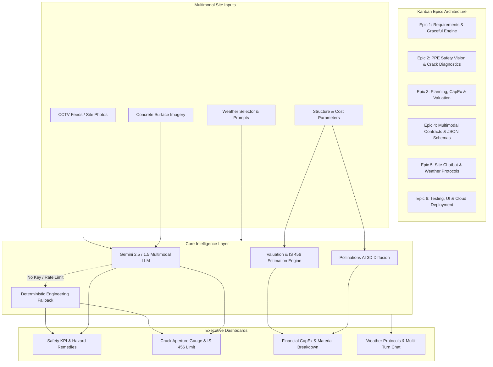

# 🏗️ Multimodal Construction Intelligence Platform
### Skill Wallet Capstone Project 1 — Turnkey Production AI System
**Category:** Generative AI | Real Estate Decision Support  
**Platform ID:** `6ac4c98d1dcde6d7857c1642`  
**Deployment Target:** Streamlit Community Cloud (Zero-DB Dependency)

---

## 🎯 Executive Overview & Scope
The **Multimodal Construction Intelligence Platform** is an enterprise-grade AI decision-support system engineered for civil engineers, site safety auditors, project managers, and real estate developers. It integrates multimodal computer vision, forensic structural analysis, algorithmic construction cost engineering, and dynamic meteorological advisory into a unified single-pane operational cockpit.

### Core Modules:
1. **🦺 Site Safety & Worker PPE Compliance Audit (Epic 2):** Multimodal forensic vision analyzing worker compliance (helmets, high-vis vests, steel-toe boots, fall arrest harnesses) under **OSHA 29 CFR 1926** and Indian Standard **IS 456 / IS 3521 / IS 2925**. Identifies life-critical hazards with severity ratings and corrective remedies.
2. **🔍 Crack Diagnostics & Structural Integrity (Epic 2):** Forensic defect classification (Hairline, Settlement, Structural Shear, Thermal Expansion, Spalling) with crack aperture estimation (mm), root cause diagnostics, and step-by-step engineering rehabilitation roadmaps under **IS 456:2000 Cl. 35.3.2** and **ACI 224R**.
3. **📊 Planning & Real Estate Valuation in INR (Epic 3):** Parametric cost estimation, CapEx incurred tracking, current market asset valuation (Lakhs/Crores), IS 456 material quantification (rebar steel, cement, RMC), and conceptual 3D architectural rendering via Pollinations AI / Flux.
4. **🌦️ Daily Site Assistant & Weather-Aware Advisory (Epic 5):** Real-time meteorological protocols (crane operations, high-wind cutoff, hot-weather curing, electrical pump isolation) and an interactive multi-turn civil engineering assistant chatbot.

---

## 🗺️ Kanban Epics Architecture & Coverage



| Kanban Epic | Scope & Implementation | Verification |
| :--- | :--- | :--- |
| **Prerequisites** | Python 3.9+, Streamlit, Pillow, Plotly, Google GenAI SDK | `python --version`, `pip list` |
| **Epic 1** | Secure API Key management with automated graceful fallback to high-fidelity simulation when no key is supplied | `GeminiEngine.analyze_image_multimodal()` |
| **Epic 2** | Multimodal PPE compliance audit (helmets, vests, boots, harnesses) and forensic crack diagnostics (shear, hairline, spalling) | Tab 1 & Tab 2 with interactive visual gauges |
| **Epic 3** | Construction budgeting, CapEx incurred, INR real estate valuation, steel/cement quantification, and 3D rendering | Tab 3 with live parametric recalculation |
| **Epic 4** | Rigid JSON data contracts, structured schemas, and one-click JSON audit downloads | Schema validators & `extract_json_from_text()` |
| **Epic 5** | Weather advisory matrices (high wind crane cutoffs, rain, extreme heat curing) & multi-turn engineering chatbot | Tab 4 with persistent chat session |
| **Epic 6** | Modern industrial dark UI, unit test suite, and Streamlit Community Cloud readiness | `tests/test_modules.py` (7/7 passed) |

---

## 🏗️ Technical Specifications & Standards Matrix

### 1. Safety & PPE Compliance (Tab 1)
- **Head Protection:** OSHA 1926.100 / IS 2925 (Industrial Safety Helmets - Class E/G)
- **High-Visibility Apparel:** OSHA 1926.201 / EN ISO 20471 (Class 2 / Class 3 retroreflective waistcoats)
- **Footwear:** OSHA 1926.96 / IS 15298 (Steel-toe puncture resistant footwear)
- **Fall Protection:** OSHA 1926.502 / IS 3521 (Full body harnesses, static lifelines, 100% tie-off > 1.8m)
- **Scaffolding:** OSHA 1926.451 / IS 4014 (Top rails @ 42", mid-rails @ 21", 6" toeboards)

### 2. Concrete Crack Limits & Forensic Diagnostics (Tab 2)
Under **IS 456:2000 Cl. 35.3.2 (Limit State of Serviceability - Cracking)**:
- **Mild Exposure:** Maximum surface crack width $w_{\max} = 0.30\text{ mm}$
- **Moderate Exposure:** Maximum surface crack width $w_{\max} = 0.20\text{ mm}$
- **Severe / Marine Exposure:** Maximum surface crack width $w_{\max} = 0.10\text{ mm}$
- **Water Retaining Structures (IS 3370):** Maximum crack width $0.10\text{ mm}$
- **Engineering Repair Standards:** Low-pressure structural epoxy injection (ASTM C881 Type I/IV), CFRP composite wrapping (ACI 440.2R), and polymer-modified mortar (PMM EN 1504-3).

### 3. Real Estate Valuation & Material Quantities (Tab 3)
- **CapEx Tracking:** $\text{CapEx Incurred} = \text{Total Construction Budget} \times \left(\frac{\text{Completion \%}}{100}\right)$
- **Realizable Market Valuation:** $\text{Current Valuation} = (\text{Finished Market Value} \times 0.38) + [(\text{Finished Market Value} \times 0.62) \times \text{Completion Ratio}]$
- **Structural Steel Consumption (IS 456 / SP 23):** $3.5\text{ to } 5.5\text{ kg/sq.ft}$
- **Cement Consumption:** $0.40\text{ to } 0.50\text{ bags/sq.ft}$ ($20-25\text{ kg/sq.ft}$)
- **Ready-Mix Concrete (RMC):** $0.035\text{ to } 0.050\text{ m}^3\text{/sq.ft}$

---

## 🚀 Quickstart & Local Installation

### 1. Clone or Open Workspace
```bash
cd "d:\skill wallet project"
```

### 2. Install Dependencies
```bash
pip install -r requirements.txt
```

### 3. Run Automated Tests
```bash
python -m unittest tests/test_modules.py
```

### 4. Launch Streamlit Application
```bash
streamlit run app.py
```
Open your browser at `http://localhost:8501`.

---

## 🌐 1-Click Streamlit Community Cloud Deployment
This project is engineered with **zero external database dependencies** and clean stateless session caching, making it immediately deployable on [Streamlit Community Cloud](https://streamlit.io/cloud):

1. Push this repository to GitHub.
2. Log into Streamlit Cloud and select **"New App"**.
3. Point to the repository, set the main file path to `app.py`, and click **Deploy**.
4. *(Optional)* Add your `GEMINI_API_KEY` under **App Settings > Secrets**:
   ```toml
   GEMINI_API_KEY = "AIzaSy..."
   ```
*(Note: If no API key is added, the platform automatically runs in its calibrated Demonstration Mode with full UI interactivity and instant sample testing).*

---

## 📁 Repository Structure
```
d:\skill wallet project\
├── app.py                     # Streamlit single-pane cockpit & custom CSS
├── requirements.txt           # Production dependencies for cloud deployment
├── README.md                  # Comprehensive architectural documentation
├── .streamlit/
│   └── config.toml            # Modern industrial dark theme configuration
├── modules/
│   ├── __init__.py
│   ├── gemini_client.py       # Multimodal Gemini 2.5/1.5 API & resilient fallback
│   ├── safety_audit.py        # Epic 2: OSHA/IS 456 PPE vision prompt & JSON contracts
│   ├── crack_diagnostics.py   # Epic 2: Concrete crack classification & repair roadmap
│   ├── valuation_planner.py   # Epic 3: Budgeting, CapEx, INR valuation & Pollinations AI
│   ├── weather_assistant.py   # Epic 5: Weather safety protocols & engineering chatbot
│   └── sample_generator.py    # Offline programmatic sample image generator
├── tests/
│   └── test_modules.py        # Automated test suite (7/7 tests passed)
└── assets/
    ├── sample_site_ppe_hazard.png
    ├── sample_site_ppe_compliant.png
    ├── sample_crack_structural_shear.png
    ├── sample_crack_hairline_plaster.png
    └── sample_crack_spalling_corrosion.png
```

---

## 🔒 Security & Graceful Fallback Architecture
- **API Key Masking:** API key inputs use password masking and are stored strictly in browser session memory.
- **Resilient Fallback:** If network connectivity fails, API quotas are reached, or no key is provided, the platform transparently switches to deterministic engineering models without crashing.
- **Zero Database Footprint:** Runs completely in-memory using `st.session_state` for instantaneous, zero-cost cloud deployment.
